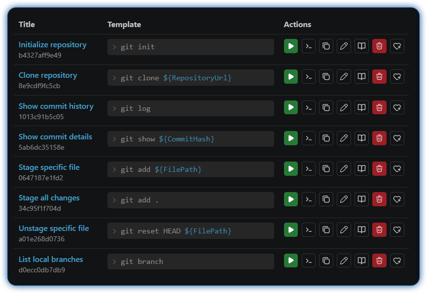

<!-- LOGO_START -->

  

<!-- LOGO_END -->

# RunBox

**Your terminal command library inside VS Code: store, organize, and launch your everyday commands in one click, with reusable variables, favorites, automatic shell matching, and AI that writes and explains commands for you.**

RunBox gives you a central panel inside VS Code for the terminal commands you use again and again. Store them once, organize them by category and group, fill in their changing parts with variables, and run them in the right shell and folder with a single click, in every project you open.

## Why RunBox?

- **Stop retyping and hunting for commands.** Long or rarely used commands live in one organized place instead of your shell history, notes, or browser tabs.
- **One template, many values.** `${variableName}` placeholders turn a command into a reusable template, and the values you enter can be remembered per project or globally.
- **The right shell, every time.** Tag a command with the shell it was written for, and RunBox pre-selects a matching terminal profile when you run it.
- **AI when you need it.** Generate a complete set of commands from a plain-language description, or get any command explained, using your own API key from one of 8 providers.

## Key Features

### 📂 Categories & Groups

Organize commands into **categories** and **groups** (for example, MySQL → Setup, Build, Deploy). Create, rename, and delete both. Filter the command table by category and group, toggle visible columns, and drag rows to reorder them within a group.

 

### ⚡ Run, Use, or Copy

| Action   | What it does                                                                           |
| -------- | -------------------------------------------------------------------------------------- |
| **Run**  | Executes the command after a confirmation dialog where you can choose the shell to use |
| **Use**  | Pastes it into the terminal input so you can review or edit it before running          |
| **Copy** | Copies the resolved command to your clipboard                                          |

 

### 🔤 Variables

Add `${variableName}` placeholders to any command template. When you run or use the command, a dialog prompts you to fill in the values.

#### Three Independent Scopes

Each variable value can be saved in one of three independent scopes:

| Scope      | Saved to                                                                           | Best for                               |
| ---------- | ---------------------------------------------------------------------------------- | -------------------------------------- |
| **Local**  | `.vscode/runbox.data.json` (or the folder set by `runBox.localWorkspaceFilesPath`) | Values that differ per project         |
| **Global** | `~/.runbox/data.json`                                                              | Values shared across all projects      |
| **Off**    | Session memory only, never written to disk                                         | One-time values you don't need to keep |

Switching the scope toggle never deletes the value stored in the other scopes.

#### Auto Variables

`${@date}`, `${@time}`, `${@username}`, `${@workspaceFolder}`, and `${@workspaceName}` are resolved automatically, with no input required. The `@` marker keeps them separate from your own variables, so a plain `${date}` stays a regular variable you fill in.

#### Enum Variables

Predefine a fixed list of options for a variable and pick one from a dropdown when you run the command, for example `${env}` with `dev`, `staging`, and `production`.

#### Keyboard Shortcuts for Variable Fields

While a variable field is focused in the variables dialog, press **Ctrl+Shift+E** (⌘⇧E on macOS) to set it to an empty value, or **Ctrl+Shift+O** (⌘⇧O) to pick a file path with the native file dialog. These shortcuts only take over from VS Code's own shortcuts while a variable field has focus.

 

### ✨ Generate Commands with AI

Describe what you need in plain language (for example, "commands to manage a MySQL database"). Use **Create with AI** to generate a complete category with groups and commands, or **Add with AI** to generate a single command for the selected group. Review the results, select the ones you want, and insert them.

**8 AI providers supported:** Google Gemini · OpenAI · Anthropic Claude · DeepSeek · Groq · Mistral AI · Cohere · StepFun

> [!NOTE]
> AI features are optional and use your own API key. Open the panel, click **AI Settings**, choose a provider, and paste your key. Several providers offer **free tiers**: Gemini, DeepSeek, and Groq are good starting points. See the [FAQ](docs/faqs.md) for where to get a key.

 

### 📖 Explain Commands with AI

Click the **Explain** button on any command to get a structured breakdown: what it does, what each part means, practical examples, and warnings. The result is rendered directly inside the panel. Ctrl/Cmd+click the button to choose a different language for a single explanation.

 

### ⭐ Favorites

Add any command to **Global** favorites (available in every project), **Local Workspace** favorites (this project only), or both. Click the favorite button to choose, or use the shortcuts: Ctrl/Cmd+click adds to Global, Shift+click adds to Local, and Ctrl/Cmd+Shift+click adds to both. From the Favorites tab, you can jump back to the original command at any time.

 

### 🕘 Recent Commands

Every command you run or use is tracked with its last run time and run count. Revisit or re-run recent commands from the Recent tab without searching the full list, and clear the history whenever you like.

 

### 🖥️ Target Shell

Assign a target shell (Windows PowerShell, PowerShell 7+, Command Prompt, Bash / Git Bash, WSL, Zsh, or Sh) to any command from the Add/Edit form. When you click **Run**, RunBox pre-selects a terminal profile on your machine that matches it, and you can still pick any other profile before confirming. A small indicator below the field shows whether your selection matches a configured profile. Commands generated by AI are tagged with the shell you generate them for, so their syntax matches it.

> [!TIP]
> The target shell is a suggestion, never a restriction. If no profile matches, or the command is set to **Any Shell**, VS Code's default terminal profile is used. See the [FAQ](docs/faqs.md) for how profiles are matched.

 

### 🗂️ Current Workspace

A special category that always appears first whenever a workspace folder is open. Commands and groups added under **Current Workspace** are stored privately in `.vscode/runbox.data.json` (or in the folder set by `runBox.localWorkspaceFilesPath`) instead of the shared global file, so they appear only in this exact workspace folder and never in any other project.

This is useful for commands that only make sense for one specific project, such as a project-specific build script, that you never want showing up when you open a different project.

> [!NOTE]
> Commands under **Current Workspace** can only be added to **Local Workspace** favorites (never Global), and their variables can only use the **Local** or **Off** scope (never Global).

 

### 🗃️ Multi-Root Workspace Support

A workspace folder selector appears in the panel when you work in a multi-root workspace. Local variables, local favorites, and auto variables such as `${@workspaceFolder}` and `${@workspaceName}` automatically reflect the selected folder, and **Run** opens the terminal in that folder.

How the folder is chosen when the panel opens is controlled by the `runBox.multiRootFolderResolution` setting. See the [Settings Reference](docs/settings.md) for the available modes.

 

### 🛡️ Safe Across Multiple Windows

Open RunBox in as many VS Code windows as you like, whether they show different projects or the same project (opened again with **File > Duplicate Workspace**). Every save is written atomically, and saving a command, a favorite, or a variable value in one window never erases what another window just saved. Every open window also updates live to reflect changes made elsewhere. If two windows edit the exact same command at the same time, a dialog lets you choose which version to keep.

 

## Data Storage, Backup & Sharing

RunBox stores everything in plain JSON files that you can open, back up, or share:

| File                                             | Contents                                                               | Open from the panel with  |
| ------------------------------------------------ | ---------------------------------------------------------------------- | ------------------------- |
| `~/.runbox/commands.json`                        | All global categories, groups, and commands                            | **Open Global JSON**      |
| `~/.runbox/data.json`                            | Global variable values and Global favorites                            | **Open Global Data JSON** |
| `.vscode/runbox.data.json` (inside each project) | Current Workspace commands, Local variable values, and Local favorites | **Open Local Data JSON**  |

To back up your command library or share it with your team, copy `~/.runbox/commands.json`, plus `~/.runbox/data.json` if you also want your global variable values and favorites. Anyone can restore them by placing the files at the same paths on their machine.

## Privacy & Security

- **API keys** are stored in VS Code's `SecretStorage`, which uses your operating system's credential manager. They are never written to settings or workspace files.
- **No telemetry.** RunBox does not collect or send usage data.
- **AI requests** are sent only when you use an AI feature, and only to the provider you selected. They contain your prompt (and the name of the selected terminal profile) when generating, or the command template when explaining.
- **Local data files** (`.vscode/runbox.data.json`) can contain variable values such as hostnames or tokens. Add the file to `.gitignore` if your project is shared.

## Requirements

- VS Code 1.90.0 or later.
- An API key from a supported provider, only if you want to use the AI features.

## Getting Started

1. Install RunBox from the [VS Code Marketplace](https://marketplace.visualstudio.com/items?itemName=Abdulla-Aldosari.runbox) or [Open VSX](https://open-vsx.org/extension/Abdulla-Aldosari/runbox), or search for **RunBox** in the Extensions view.
2. Open the panel with `F4 F4` (press F4 twice), or run **RunBox: Open Panel** from the Command Palette.
3. Create a category and, optionally, add groups to it.
4. Add your first command. Use `${variableName}` placeholders for any values that change between runs.
5. Click **Run**, **Use**, or **Copy** to execute it.

## Documentation

- [Settings Reference](docs/settings.md): all configuration options explained
- [Frequently Asked Questions](docs/faqs.md): common questions and troubleshooting
- [Changelog](CHANGELOG.md): release history

## License

[MIT](LICENSE)
