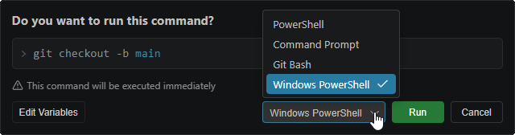
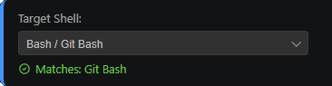
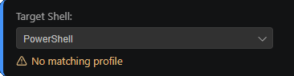
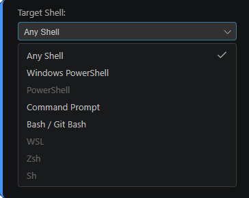
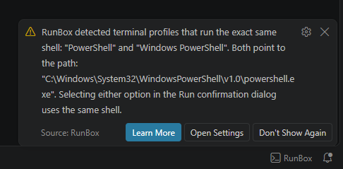
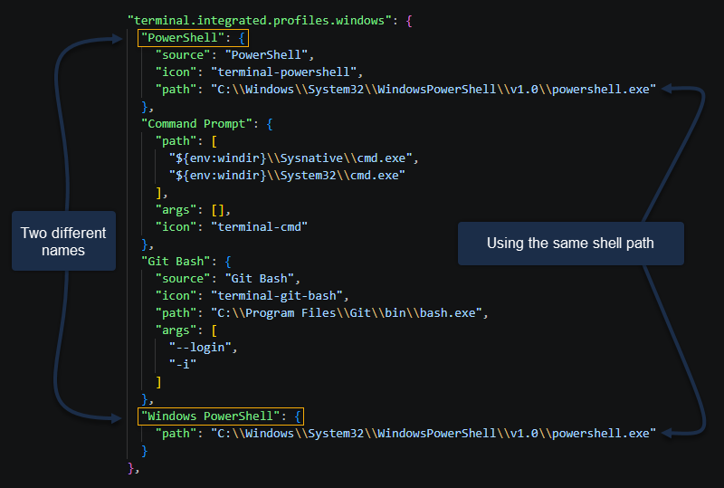

# 📄 RunBox: Frequently Asked Questions

<br>

## 📚 General

### 🔵 Where are my commands stored?

All commands and categories are stored globally in a single JSON file on your machine:

```
~/.runbox/commands.json
```

This file is shared across all your VS Code workspaces, so your commands are always available no matter which project you open. You can open and edit this file directly from the panel using the **Open Global JSON** button in the header.

---

### 🔵 Does RunBox support multi-root workspaces?

Yes. When you open a multi-root workspace (a `.code-workspace` file with multiple folders), a **workspace folder selector** dropdown appears below the panel header. You can switch between folders at any time. Local variables, local favorites, and auto variables such as `${workspaceFolder}` and `${workspaceName}` all update to reflect the selected folder.

The **Run confirmation dialog** also includes a per-execution folder override, so you can run a command against a different folder without changing the panel's active selection. The terminal opens in the chosen folder's directory.

How the folder is chosen when the panel opens is controlled by the `runBox.multiRootFolderResolution` setting. See the [Settings Reference](settings.md) for details.

---

### 🔵 What is "Current Workspace" in the Commands Browser?

**Current Workspace** is a special entry that always appears first in the category list, both in the **Categories & Groups** tab and in the **Commands Browser** dropdown on the **Commands** tab, whenever a workspace folder is open. Unlike regular categories, commands and groups added under **Current Workspace** are stored privately in `runbox.data.json` inside this project's `.vscode/` folder (or in the path set by `runBox.localWorkspaceFilesPath`) and are never written to the shared `~/.runbox/commands.json` file. They are visible and usable only in this exact workspace folder, never in any other project.

This is useful for commands that only make sense for one specific project (for example a project-specific build script or a database connection string) and that you never want to see when you open a different project.

The first time you add a group or a command under **Current Workspace**, RunBox automatically creates a `runBox.workspaceID` setting for that folder to link the data to it. You don't need to configure anything manually. Until then, the entry is shown empty.

**Limitations:** commands under **Current Workspace** can only be added to **Local Workspace favorites** (never Global), and their variables can only use the **Local** or **Off** scope (never Global). These commands never leave this workspace folder, so a Global value or favorite could never be read back from any other project.

---

### 🔵 Is it safe to have RunBox open in multiple VS Code windows at the same time?

Yes. RunBox is designed to be used in several VS Code windows at once, whether they show several different projects or the same project (VS Code opens a folder in a second window only through **File > Duplicate Workspace**). All windows share the same global files in `~/.runbox/`, and windows showing the same project also share its `.vscode/runbox.data.json`.

- **Every save is written safely.** Files are written atomically (to a temporary file that is then renamed), so a crash or interruption in the middle of a save can never leave a corrupted file on disk.
- **Saving never loses another window's changes.** Adding, deleting, or reordering commands, adding or removing favorites, and saving variable values are each applied to the current content of the file at the moment of saving, not to a stale copy held in memory. If another window added a command or changed a value a second ago, your save does not erase it.
- **Other windows update live.** If you change commands, favorites, variable values, or Auto Variables settings in one window, every other open window reflects the change automatically, without closing and reopening the panel.
- **Editing the exact same command in two windows at once is the one case that needs your input.** If two windows have the same command open for editing and both try to save, the second window to save sees a dialog explaining that the command was changed elsewhere. It offers two choices: **Overwrite anyway** (save your version over the other one) or **Discard my changes** (reload the newer version instead). This is rare, and it exists so that neither window's edit can silently disappear.

---

### 🔵 Can I back up my commands or share them with my team?

Yes. Copy `~/.runbox/commands.json` to a safe location, or commit it to a shared repository, plus `~/.runbox/data.json` if you also want your Global variable values and Global favorites. To restore them, replace the files at the same paths. Anyone who has these files can load your full set of commands by placing them at the same paths on their machine.

---

### 🔵 What is the difference between Run, Use, and Copy?

| Action   | What it does                                                                                                             |
| -------- | ------------------------------------------------------------------------------------------------------------------------ |
| **Run**  | Sends the resolved command to the terminal and executes it immediately. A confirmation dialog appears first.             |
| **Use**  | Pastes the resolved command into the terminal input without pressing Enter, so you can review or edit it before running. |
| **Copy** | Copies the resolved command to your clipboard. Nothing is sent to the terminal.                                          |

---

<br>

## 🏷️ Variables

### 🔵 How do the three variable scopes work?

Every variable in a command can be saved in one of three independent scopes. The **Local / Off / Global** toggle on each variable row controls which scope is active for that variable:

| Scope      | Where the value is saved                                      | When to use it                                                                                            |
| ---------- | ------------------------------------------------------------- | --------------------------------------------------------------------------------------------------------- |
| **Local**  | `.vscode/runbox.data.json` inside your current project folder | When the value is specific to this project (e.g. a database name, a port number that differs per project) |
| **Global** | `~/.runbox/data.json` in your home directory                  | When you use the same value across all your projects (e.g. your username, a shared server address)        |
| **Off**    | In memory only, never written to disk                         | When you want to fill in a value just for this session without saving it anywhere                         |

Switching the toggle does **not** delete the value stored in the other scopes. Each scope stores its value independently.

---

### 🔵 What are Auto Variables?

Auto Variables are built-in variables that are resolved automatically, with no input from you:

| Variable             | Resolved value                                                                                                                          |
| -------------------- | --------------------------------------------------------------------------------------------------------------------------------------- |
| `${date}`            | Today's date (the format is configurable in the **Variables** tab)                                                                      |
| `${username}`        | Your operating system username                                                                                                          |
| `${workspaceFolder}` | The full path to the active workspace folder. In multi-root workspaces, reflects the folder selected in the panel's workspace selector. |
| `${workspaceName}`   | The folder name (basename) of the active workspace folder. In multi-root workspaces, reflects the selected folder.                      |

> [!NOTE]
> **Multi-root workspaces:** `${workspaceFolder}` and `${workspaceName}` always reflect the folder that is currently active in the panel. Switching the workspace folder dropdown updates these values for all subsequent command executions. You can also override them per-execution in the Run confirmation dialog.

---

### 🔵 What are Enum Variables?

Enum Variables let you define a fixed list of allowed values for a variable. Instead of typing a value, you choose from a dropdown of your predefined options when you run or use the command. This is useful for variables such as `${env}` (with the options `dev`, `staging`, and `production`) or `${region}`.

To define enum options, open the **Edit Command** form for any command and click the enum manager icon next to the variable name.

---

### 🔵 Are there keyboard shortcuts for variable fields?

Yes. While a variable field has focus, RunBox provides two shortcuts:

| Action                                                         | Windows / Linux | macOS | Where it works                                                                                          |
| -------------------------------------------------------------- | --------------- | ----- | ------------------------------------------------------------------------------------------------------- |
| Set the field to an empty value (or restore the previous text) | `Ctrl+Shift+E`  | `⌘⇧E` | The variables dialog shown before you run or use a command, and the variable fields of the command form |
| Pick a file path with the file dialog                          | `Ctrl+Shift+O`  | `⌘⇧O` | The variables dialog only                                                                               |

For an enum variable, focus its dropdown and press the empty-value shortcut: RunBox switches it to **Custom value...** and sets the empty value.

These shortcuts only take over from VS Code's own shortcuts (**Explorer** and **Go to Symbol**) while a variable field has focus. As soon as you click away from the field or close the panel, `Ctrl+Shift+E` and `Ctrl+Shift+O` work as usual in VS Code.

If another extension uses the same keys, or you prefer different ones, open **Keyboard Shortcuts** (`Ctrl+K Ctrl+S` / `Cmd+K Cmd+S`) and search for `RunBox`. The two commands are named **RunBox: Toggle Empty Value for the Focused Variable** and **RunBox: Pick a File for the Focused Variable**. The hint shown under the variable fields keeps displaying the default keys.

---

<br>

## 🤖 AI Assistant

### 🔵 How do I get an API key for the AI assistant?

Each provider has a free option to get started:

| Provider          | Get API Key                                                                        |
| ----------------- | ---------------------------------------------------------------------------------- |
| **Google Gemini** | [aistudio.google.com](https://aistudio.google.com/): free tier available           |
| **DeepSeek**      | [platform.deepseek.com](https://platform.deepseek.com/): free tier + very low cost |
| **Groq**          | [console.groq.com](https://console.groq.com/): free tier with fast inference       |
| **Mistral AI**    | [console.mistral.ai](https://console.mistral.ai/): free models available           |
| **Cohere**        | [dashboard.cohere.com](https://dashboard.cohere.com/): free trial available        |
| **StepFun**       | [platform.stepfun.com](https://platform.stepfun.com/): free model available        |
| **OpenAI**        | [platform.openai.com](https://platform.openai.com/): paid                          |
| **Anthropic**     | [console.anthropic.com](https://console.anthropic.com/): paid                      |

Once you have a key, open the panel, click **AI Settings**, select your provider, paste the key, and click **Save Key**.

---

### 🔵 How do I generate commands with AI?

1. Go to the **Categories & Groups** tab and select a category and group.
2. Click **Create with AI**, or go to the **Commands** tab and click **Add with AI**.
3. Describe what you want in plain language (for example, "commands to manage a MySQL database").
4. The AI generates a set of commands. Review them, select the ones you want, and click **Insert Selected**.

---

### 🔵 What does the AI Explain button do?

The **Explain** button (available on each command row in the **Commands** tab) sends the raw command template to the AI and returns a structured breakdown: what the command does, what each part means, practical examples, and any warnings. The explanation appears directly inside the panel as formatted text. Ctrl+click the button to choose a different language for a single explanation.

---

<br>
<br>

## 🛠️ Troubleshooting

### 🔵 A command runs in the wrong shell on Windows

By default, RunBox uses your VS Code default terminal profile. If you need to run a command in a specific shell (for example PowerShell, Command Prompt, or Git Bash), use the **shell selector** dropdown in the Run confirmation dialog to choose the shell before confirming. You can also set a **Target Shell** on the command itself (see the next topic).

---

### 🔵 What are terminal profiles, and how does RunBox use them?

A **terminal profile** is a VS Code concept, not something specific to RunBox. It is a named shortcut to a shell program (like PowerShell, Command Prompt, or Bash) that VS Code's integrated terminal can open. You can view and edit your profiles through the Settings UI (search for "terminal profiles") or by editing your `settings.json` file directly (Command Palette → "Preferences: Open User Settings (JSON)"). The setting name depends on your operating system:

<a name="profile-setting-names"></a>

- Windows: `terminal.integrated.profiles.windows`
- macOS: `terminal.integrated.profiles.osx`
- Linux: `terminal.integrated.profiles.linux`

When you open the **Run confirmation dialog** in RunBox, it includes a dropdown to pick which terminal profile to run the command in. This dropdown lists the profiles available in your VS Code settings, no more and no less. RunBox never adds shells that you haven't already configured.



Separately, when adding or editing a command, you can set an optional **Target Shell** (Any Shell, Windows PowerShell, PowerShell, Command Prompt, Bash / Git Bash, WSL, Zsh, Sh). This is a general category describing which kind of shell the command's syntax was written for, and it is not the same list as your configured profiles. Think of it as "this command speaks PowerShell" versus the Run dialog's list, which says "these are the shells configured on your computer."

> [!NOTE]
> **Windows PowerShell** and **PowerShell** are two different programs that are installed independently, not one program with two names. Windows PowerShell (5.1) ships with every Windows PC. PowerShell (7 or newer) is a separate, modern program that you install yourself, and it runs side by side with Windows PowerShell rather than replacing it. Picking the wrong one when both are installed only affects which profile RunBox pre-selects for you. You can always switch it in the Run confirmation dialog.

When you run a command that has a Target Shell set, RunBox looks through your configured profiles and pre-selects the first one that matches that category in the Run confirmation dialog. This is a convenience suggestion, never a restriction: you can pick a different profile before confirming, and the command runs normally either way. If none of your profiles match, or the command is set to **Any Shell**, RunBox uses your VS Code default terminal profile. A profile you pick manually in the dialog applies to that run only and never changes what other commands use.

To make this pre-selection transparent, the Add/Edit Command form shows a short indicator right below the **Target Shell** field. It always reflects your current selection: a green **"Matches: \<profile name\>"** when a configured profile resolves to that shell type, or a yellow **"No matching profile"** when none does. Hover over the indicator to see the full executable path it resolves to and, if more than one of your profiles points to that same executable (see the duplicate profiles topic below), which other profile names are equivalent.





The same information appears in the **Target Shell** dropdown itself: any option with no matching profile on your machine is dimmed in the list, even before you select it. This is purely visual. Every option remains selectable, because Target Shell is always a suggestion and never a restriction.



---

<a id="duplicate-terminal-profiles"></a>

### 🔵 RunBox warned me about duplicate terminal profiles. What should I do?

VS Code allows two or more profile entries, even with different names, to point to the same program on disk. A common example on Windows is a profile named "PowerShell" and another named "Windows PowerShell" that both point to the same file. When this happens, choosing either one in the Run confirmation dialog opens the same kind of terminal session, so the choice has no real effect.

RunBox checks for this once, the first time you open the panel in a VS Code session. If duplicate profiles are found, it shows a notice naming the affected profiles:



- **Learn More** opens this FAQ section for full context.
- **Open Settings** jumps you directly to your terminal profiles settings.
- **Don't Show Again** dismisses the notice for that exact situation. If your profile setup changes later and a new duplication appears, RunBox shows a new notice for it.

> [!NOTE]
> This notice is purely informational. RunBox never changes, deletes, or restricts any of your terminal profiles or settings.

**Why does this happen?** "Windows PowerShell" is the classic version built into every Windows PC, and nothing needs to be installed. "PowerShell" (sometimes called "PowerShell 7") is a separate, more modern version that must be installed independently. It does not replace the classic one, and both can exist on the same machine. A profile's name is just a label and does not guarantee which program the profile points to, so two differently named profiles can end up pointing to the same program if both were configured with the same file.

**How to check and fix it:**

1. Open the Command Palette (`Ctrl+Shift+P` / `Cmd+Shift+P`) and run "Preferences: Open User Settings (JSON)", or use the **Open Settings** button from RunBox's notice, which jumps here directly.
2. Look for the terminal profiles setting matching your operating system [(see the setting names above)](#profile-setting-names), then click `Edit in settings.json`.
3. Find the profile names mentioned in RunBox's notice, and compare the `path` (or `source`) value under each one.

   

4. If you have two different programs installed (for example, you installed the newer PowerShell separately) but both profiles point to the same classic path, update the `path` of one profile to point to the newer program's install location. That location depends on how PowerShell 7 was installed on your machine. You can find it through Microsoft's official installation instructions.
5. If you do not have two different programs installed (both names genuinely point to the same program, which is common and harmless), there is nothing to fix. Pick either profile in the Run dialog, since both behave identically, and dismiss the notice with **Don't Show Again**. This is not a bug and not something you did wrong.

This situation is not a RunBox error and does not affect normal use. It is only a heads-up about a VS Code settings detail that most users would otherwise never notice.

> [!NOTE]
> This topic also applies to macOS and Linux, with different setting names (see above) and different default shells (such as zsh, bash, or sh instead of PowerShell and Command Prompt).

---

### 🔵 The panel is not opening

Open the Command Palette (`Ctrl+Shift+P` / `Cmd+Shift+P`) and run **RunBox: Open Panel**, or press `F4 F4` (two consecutive presses of the F4 key).

---

<br>

## 🧾 Related

- [Back to README](../README.md)
- [Settings Reference](settings.md)
